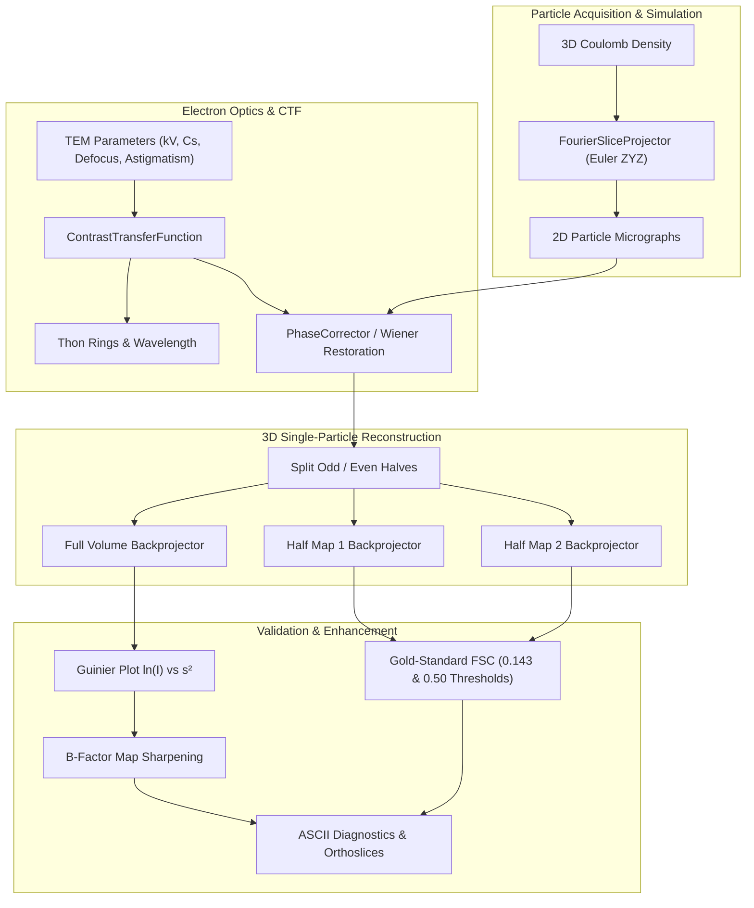

# SpectroBio

[](https://github.com/ZengLLQ/spectro-bio/actions/workflows/ci.yml)
[](https://www.python.org/)
[](https://opensource.org/licenses/MIT)

**SpectroBio** is a rigorous, high-performance Python package for Cryo-Electron Microscopy (Cryo-EM) single-particle macromolecular 3D reconstruction, Contrast Transfer Function (CTF) optics modeling, phase correction, Gold-Standard Fourier Shell Correlation (FSC) resolution assessment, and Rosenthal-Henderson B-factor map sharpening.

---

## Key Features

- **Relativistic TEM Wave Optics**: Exact calculation of relativistic de Broglie electron wavelength, spherical aberration phase shifts, astigmatic defocus, and envelope decay damping for modern 200 kV and 300 kV transmission electron microscopes (e.g., Thermo Fisher Titan Krios, Talos Arctica).
- **Astigmatic Thon Ring Modeling**: Analytical 1D and 2D CTF simulation with arbitrary defocus astigmatism magnitude and principal azimuth angles.
- **Phase Restoration**: Fourier space contrast phase flipping and SNR-weighted Wiener deconvolution.
- **Euler Angle Rotations & Forward Projections**: High-precision ZYZ 3D rotations and transmission integral forward projections obeying the Fourier Slice Theorem.
- **Reciprocal Filtered Backprojection**: 3D direct reciprocal backprojection with Ram-Lak and Shepp-Logan spatial frequency filtering.
- **Gold-Standard Fourier Shell Correlation (FSC)**: Independent odd/even half-dataset cross-correlation with 0.143 (unbiased signal-to-noise ratio SNR=0.5 threshold) and conservative 0.50 resolution criteria.
- **Guinier B-Factor Analysis & Sharpening**: Rosenthal-Henderson B-factor estimation from radial power spectra and high-frequency cosine falloff sharpening.
- **Terminal Visualizer**: Built-in ASCII visualizer for Thon rings, FSC resolution curves, and 3D density orthoslices (Axial, Coronal, Sagittal).

---

## Mathematical & Physical Foundations

### 1. Relativistic Electron Wavelength
Electrons accelerated through an electric potential $V$ (Volts) undergo relativistic mass increase:

$$\lambda = \frac{h}{\sqrt{2 m_0 e V \left(1 + \frac{e V}{2 m_0 c^2}\right)}} = \frac{12.2643}{\sqrt{V (1 + 0.978466 \times 10^{-6} V)}} \quad [\text{Å}]$$

At $300\text{ kV}$, $\lambda \approx 0.019687\text{ Å}$; at $200\text{ kV}$, $\lambda \approx 0.025079\text{ Å}$.

### 2. Contrast Transfer Function (CTF)
The phase aberration function $\chi(s, \theta)$ incorporates defocus and third-order spherical aberration $C_s$:

$$\chi(s, \theta) = \pi \lambda \Delta f(\theta) s^2 - \frac{1}{2} \pi C_s \lambda^3 s^4 - \Delta \phi$$

where spatial frequency is $s = |\mathbf{s}|$ (in $1/\text{Å}$), and astigmatic defocus $\Delta f(\theta)$ is:

$$\Delta f(\theta) = \frac{\Delta f_u + \Delta f_v}{2} + \frac{\Delta f_u - \Delta f_v}{2} \cos(2(\theta - \theta_{\text{ast}}))$$

The combined phase and amplitude CTF is modulated by an envelope decay function $E(s)$:

$$\text{CTF}(s, \theta) = \left[ -\sqrt{1 - w^2} \sin(\chi(s, \theta)) - w \cos(\chi(s, \theta)) \right] \cdot \exp\left( -\frac{B s^2}{4} \right)$$

where $w$ is the amplitude contrast ratio (typically $0.07 - 0.10$ for biological ice specimens).

```
        CTF(s)
          1.0 ┤      /\          /\
              │     /  \        /  \
          0.0 ┼────/────\──────/────\──── Thon Ring Zeros
              │   /      \    /      \
         -1.0 ┴──/────────\──/────────\──
              0.0        s_1  s_2       s [1/Å]
```

### 3. Fourier Slice Theorem & 3D Reconstruction
The Fourier Slice Theorem states that the 2D Fourier transform of a projection $P(x, y)$ equals a central slice through the 3D Fourier transform of the Coulomb density $f(\mathbf{r})$ perpendicular to the projection beam:

$$\mathcal{F}_2 \{ P_{\phi, \theta, \psi}(x, y) \} = \mathcal{F}_3 \{ f(\mathbf{r}) \} \cdot \delta(\mathbf{k} \cdot \hat{\mathbf{z}})$$

Reconstruction synthesizes $N$ oriented particle projections through filtered backprojection:

$$f(\mathbf{r}) = \frac{1}{N} \sum_{i=1}^N \mathcal{R}_i^{-1} \left\{ P_i(x, y) * h_{\text{ramp}}(x, y) \right\}$$

### 4. Gold-Standard Fourier Shell Correlation (FSC)
Particles are partitioned into two completely independent halves (Half 1 and Half 2) and reconstructed separately:

$$\text{FSC}(r) = \frac{\sum_{s \in \text{shell } r} F_1(s) F_2^*(s)}{\sqrt{\sum_{s \in \text{shell } r} |F_1(s)|^2 \cdot \sum_{s \in \text{shell } r} |F_2(s)|^2}}$$

The global resolution is reported at the $\text{FSC} = 0.143$ threshold, corresponding to Rosenthal & Henderson's criterion where map correlation with the true signal exceeds $0.5$.

### 5. Rosenthal-Henderson Guinier Sharpening
At high spatial frequencies, particle alignment inaccuracies and thermal motion cause an exponential falloff:

$$\ln \langle |F(s)|^2 \rangle = \ln |F_0|^2 - \frac{B}{2} s^2$$

Map sharpening applies an inverse envelope with a smooth cosine apodization window:

$$F_{\text{sharp}}(s) = F(s) \cdot \exp\left( \frac{B s^2}{4} \right) \cdot W_{\text{falloff}}(s)$$

---

## Architecture



---

## Installation

```bash
git clone https://github.com/ZengLLQ/spectro-bio.git
cd spectro-bio
pip install -e .
```

To run development tests:
```bash
pip install pytest
pytest -v
```

---

## Command-Line Interface (CLI)

SpectroBio includes a comprehensive CLI tool `spectro-bio`:

### 1. CTF Diagnostics & Thon Ring Analysis
```bash
spectro-bio ctf --voltage 300.0 --defocus 15000.0 --cs 2.7 --astigmatism 2000.0 --astig-angle 45.0
```
Output:
```
=================================================================
SpectroBio :: Contrast Transfer Function (CTF) Diagnostics
=================================================================
Accelerating Voltage:        300.0 kV
Relativistic Electron Wavelength: 0.019688 A
Defocus (U / V):             15000.0 / 17000.0 A
Mean Defocus:                16000.0 A
Spherical Aberration (Cs):   2.70 mm
First Thon Ring Zero (Z1):   16.48 A (s = 0.0607 1/A)
-----------------------------------------------------------------
First 5 CTF Zero Crossings (Thon Rings):
  Ring  1: s =   0.0607 1/A | Resolution =  16.48 A
  Ring  2: s =   0.0864 1/A | Resolution =  11.58 A
  Ring  3: s =   0.1054 1/A | Resolution =   9.49 A
  Ring  4: s =   0.1218 1/A | Resolution =   8.21 A
  Ring  5: s =   0.1365 1/A | Resolution =   7.32 A
=================================================================
```

### 2. Gold-Standard FSC Resolution Estimation
```bash
spectro-bio fsc --size 32 --pixel-size 1.05 --noise 0.25
```

### 3. Full End-to-End Reconstruction Pipeline
```bash
spectro-bio pipeline --size 32 --pixel-size 1.05 --n-projections 48 --snr 2.0
```

---

## Python API Usage

```python
import numpy as np
from spectro_bio import (
    ContrastTransferFunction,
    CTFParameters,
    PhaseCorrector,
    EulerAngles,
    ProjectionGeometry,
    FourierSliceProjector,
    FilteredBackprojector,
    FourierShellCorrelation,
    BFactorSharpener,
    AsciiVisualizer,
)

# 1. Setup microscope optical parameters (Titan Krios, 300 kV)
params = CTFParameters(
    accelerating_voltage_kv=300.0,
    spherical_aberration_cs_mm=2.7,
    defocus_u_angstrom=15000.0,
    defocus_v_angstrom=15000.0,
    amplitude_contrast_ratio=0.08,
)

# 2. Compute 2D CTF matrix
ctf_2d = ContrastTransferFunction.evaluate_2d_ctf(params, image_size=32, pixel_size_angstrom=1.0)

# 3. Correct phase reversals in acquired particle image
corrected_particle = PhaseCorrector.correct_phase_flipping(micrograph_noisy, ctf_2d)

# 4. Reconstruct volume from oriented particle projections
volume_3d = FilteredBackprojector.reconstruct(
    particles=[p1, p2, p3],
    geometries=[geom1, geom2, geom3],
    output_shape=(32, 32, 32),
    filter_type="shepp_logan",
)

# 5. Evaluate Gold-Standard FSC between independent half-maps
fsc_result = FourierShellCorrelation.compute_fsc(half_map_1, half_map_2, pixel_size_angstrom=1.0)
print(f"FSC 0.143 Resolution: {fsc_result.resolution_fsc_0143_angstrom:.2f} Å")
print(AsciiVisualizer.render_fsc_curve(fsc_result))

# 6. Sharpen density map using Rosenthal-Henderson Guinier analysis
guinier = BFactorSharpener.estimate_b_factor(volume_3d, pixel_size_angstrom=1.0)
sharpened_volume = BFactorSharpener.sharpen_map(
    volume_3d,
    b_factor=guinier.fitted_b_factor,
    high_res_cutoff_angstrom=fsc_result.resolution_fsc_0143_angstrom,
)
```

---

## Verification & Testing

SpectroBio runs exhaustive unit and integration testing across Linux, macOS, and Windows with Python 3.11, 3.12, and 3.14:

```bash
pytest -v
```

All 17 tests verify relativistic kinematics, CTF phase accuracy, Euler rotation orthogonality, Fourier slice integral conservation, Gold-Standard resolution limits, and Guinier negative B-factor sharpening.

---

## License

MIT License. See [LICENSE](LICENSE) for details.
